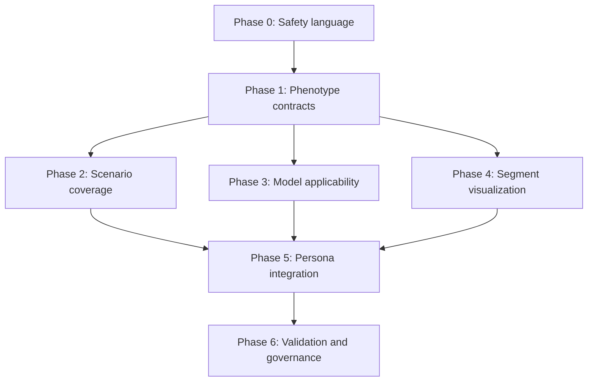

# Myocardial Infarction Representation and Regeneration Implementation Plan

## Purpose

This plan addresses the gap between the repository's current **MI classification learning module** and the broader claim that the application represents myocardial infarction anatomy, evolution, and regeneration across all supported patients.

The current MI module is a useful simulation-only classification experience. It covers primary, secondary, procedure-related, unresolved, and non-ischaemic injury patterns, including the Type 1, 2, 3, 4a, 4b, 4c, and 5 labels. It does not yet provide a complete anatomical infarct model, a clinically validated classification engine, or infarct-specific regeneration predictions.

This plan preserves the existing research-only boundary. It does not turn BD-CMR into a diagnostic, treatment-planning, device-control, or patient-specific prediction system.

## Executive decision

Implement three related but explicitly separate domains:

1. **MI assessment context** - why an authored simulation is grouped as primary, secondary, procedure-related, unresolved, or non-ischaemic injury.
2. **Infarct phenotype** - where tissue injury is located, how extensive and deep it is, when it occurred, what imaging features are present, and what complications are represented.
3. **Regeneration simulation** - which inputs a model supports, which assumptions it uses, and whether the selected case is within its declared applicability.

Do not infer one domain from another without an explicit, tested mapping. For example:

- `STEMI` does not determine infarct territory or transmurality.
- A coronary territory label does not establish a culprit vessel without evidence.
- A Type 2 MI label does not establish a scar suitable for a regeneration simulation.
- A patient identifier or baseline scar area does not make a generic trajectory patient-specific.

When required inputs are unavailable or unsupported, the product must display **Not modeled** or **Insufficient modeled inputs**. It must not silently apply a generic value and present the result as patient-specific.

## Current-state findings

### What is represented well

- `src/types/mi/classification.ts` defines all current legacy MI type labels and separates presentation from clinical grouping.
- `src/services/mi/scenarioRepository.ts` provides synthetic examples for Type 1, 2, 3, 4a, 4b, 4c, and 5, plus myocardial injury, unresolved non-obstructive coronaries, and silent/recurrent presentation.
- `src/services/mi/evaluateMiScenario.ts` preserves authored evidence gaps and always returns a simulation-only disclaimer.
- `src/components/mi/MiSpectrumWorkspace.tsx` keeps the module read-only and separates evidence, timeline, troponin trend, assessment explanation, provenance, and comparison.
- `tests/miScenarioContracts.test.ts` verifies the categorical scenario baseline.

### What is not represented adequately

1. `PatientProfile.infarctLocation` is a free-form string rather than a structured anatomical contract.
2. `apicalScarThicknessMm` assumes an apical scar even for inferolateral and posterior patients.
3. Infarct segments, chamber involvement, extent, depth, microvascular obstruction, hemorrhage, viability, edema, and source provenance are not modeled consistently.
4. Acute, subacute, and chronic cases use the same regeneration equations.
5. The regeneration engine uses common rate constants and ignores infarct mechanism, territory, morphology, stage, age, sex, comorbidity, and the supplied vitals.
6. The 3D scar and nanogrid are placed at fixed apical coordinates.
7. The regeneration UI presents deterministic heuristic bands as Bayesian credible intervals and a fixed value as model confidence.
8. Patient-facing copy uses claims such as "being cured" and guaranteed arrhythmia protection without a validation basis.
9. Only the attending, imaging reviewer, and research coordinator can open the MI spectrum workspace. Other personas do not receive a consistent plain-language infarct summary.
10. Existing tests cover classification labels and scenario behavior, but not anatomical accuracy, model applicability, regeneration differentiation, visual placement, or comprehension.

## Scope

### In scope

- Correct product terminology and simulation disclosures.
- A structured, versioned infarct phenotype contract.
- Representative scenario coverage across classification, anatomy, morphology, phase, and complications.
- Explicit model applicability and provenance for regeneration outputs.
- Segment-aware 2D and 3D visualization.
- A shared plain-language summary with persona-specific detail layers.
- Contract, unit, integration, accessibility, visual, content, and comprehension validation.
- Migration of the three existing patient cohorts without changing their synthetic status.

### Out of scope

- Real-patient diagnosis or automated MI classification.
- Treatment recommendations, dosing recommendations, or autonomous pacing decisions.
- Claims that myocardial scar is reversed or cured in humans.
- Production EHR, FHIR, DICOM, or PHI ingestion.
- Inventing territory- or phase-specific biological coefficients to create visual differentiation.
- Regulatory clearance or clinical validation.
- A patient or caregiver experience. That requires a separate intended-use and human-factors workstream.

## Design principles

1. **Evidence before specificity.** More detailed output requires more detailed source evidence.
2. **Unknown is a valid state.** Do not convert missing values into defaults that look measured.
3. **Classification is not anatomy.** Keep assessment labels and tissue phenotype independent.
4. **Simulation is visible.** The research-only state must appear before numerical outputs and in exports.
5. **No fabricated precision.** Avoid confidence percentages, credible intervals, or physiological thresholds without a documented derivation and validation set.
6. **One source of truth.** Components render typed domain objects; they do not parse display strings.
7. **Persona layering, not persona-specific facts.** Every persona sees the same underlying case facts with different emphasis and permitted actions.
8. **Safe fallback.** Unsupported cases show limitations and suppress projections rather than selecting the nearest profile silently.
9. **Version everything.** Taxonomy, phenotype schema, scenario pack, model, parameters, and exports carry immutable versions.
10. **Clinical review is a release gate.** Automated tests cannot establish medical correctness.

## Target domain model

### 1. MI assessment context

Retain `MiClinicalGroup`, `MiLegacyType`, and `MiPresentation`, but rename user-facing "legacy" wording only after clinical terminology review. The repository may need to preserve these identifiers for compatibility even if the display label changes.

Extend scenario metadata without turning `evaluateMiScenario` into a real diagnostic engine:

```ts
export interface MiAssessmentContext {
  clinicalGroup: MiClinicalGroup;
  universalDefinitionType?: MiLegacyType;
  presentation: MiPresentation;
  eventSequence: 'INDEX' | 'RECURRENT' | 'UNKNOWN';
  mechanismStatus: 'SUPPORTED' | 'POSSIBLE' | 'UNRESOLVED';
  evidenceIds: readonly string[];
  limitations: readonly string[];
}
```

The UI must continue to explain that the scenario outcome is authored simulation content, not a diagnosis generated from clinical data.

### 2. Infarct phenotype

Add `src/types/mi/infarctPhenotype.ts` with explicit unknown states and source references.

```ts
export type VentricularInvolvement = 'LV' | 'RV' | 'BIVENTRICULAR' | 'UNKNOWN';

export type InfarctPhase =
  | 'ACUTE'
  | 'SUBACUTE'
  | 'CHRONIC'
  | 'UNKNOWN';

export type InfarctDepth =
  | 'SUBENDOCARDIAL'
  | 'TRANSMURAL'
  | 'MIXED'
  | 'NOT_ESTABLISHED';

export type FindingState = 'PRESENT' | 'ABSENT' | 'INDETERMINATE' | 'NOT_ASSESSED';

export interface MyocardialSegmentFinding {
  segmentId: number;
  chamber: 'LV' | 'RV';
  scarState: FindingState;
  depth: InfarctDepth;
  extentPercent?: number;
  wallThicknessMm?: number;
  wallMotion?: 'NORMAL' | 'HYPOKINETIC' | 'AKINETIC' | 'DYSKINETIC' | 'NOT_ASSESSED';
  sourceEvidenceIds: readonly string[];
}

export interface InfarctPhenotype {
  schemaVersion: string;
  ventricularInvolvement: VentricularInvolvement;
  phase: InfarctPhase;
  daysSinceIndexEvent?: number;
  coronaryTerritories: readonly string[];
  culpritVesselStatus: 'ESTABLISHED' | 'SUSPECTED' | 'NOT_ESTABLISHED';
  culpritVessels: readonly string[];
  segments: readonly MyocardialSegmentFinding[];
  totalScarAreaCm2?: number;
  scarMassGrams?: number;
  lvExtentPercent?: number;
  microvascularObstruction: FindingState;
  intramyocardialHemorrhage: FindingState;
  edema: FindingState;
  viabilityStatus: 'VIABLE' | 'MIXED' | 'NON_VIABLE' | 'INDETERMINATE' | 'NOT_ASSESSED';
  provenance: readonly PhenotypeSourceReference[];
  limitations: readonly string[];
}
```

Use a reviewed myocardial segmentation standard. Store stable segment identifiers and map them to display names in configuration. Do not embed display labels or assumed culprit-vessel mappings in the core type.

### 3. Complication context

Represent observed or authored complications separately from risk prediction:

```ts
export type MiComplication =
  | 'VENTRICULAR_ARRHYTHMIA'
  | 'HEART_FAILURE'
  | 'CARDIOGENIC_SHOCK'
  | 'PAPILLARY_MUSCLE_DYSFUNCTION'
  | 'VENTRICULAR_SEPTAL_DEFECT'
  | 'FREE_WALL_RUPTURE'
  | 'PERICARDITIS'
  | 'LV_ANEURYSM'
  | 'LV_THROMBUS'
  | 'RECURRENT_ISCHAEMIA';

export interface ComplicationFinding {
  complication: MiComplication;
  state: FindingState;
  observedAt?: string;
  sourceEvidenceIds: readonly string[];
  limitations: readonly string[];
}
```

Do not add numerical complication-risk scores until the intended use, source population, calibration, and validation approach are approved.

### 4. Regeneration model contract

Replace implied universal applicability with an explicit contract:

```ts
export type ModelApplicabilityStatus =
  | 'SUPPORTED_SIMULATION'
  | 'PARTIALLY_SUPPORTED'
  | 'OUT_OF_SCOPE'
  | 'INSUFFICIENT_INPUTS';

export interface RegenerationModelDescriptor {
  modelId: string;
  modelVersion: string;
  mode: 'ILLUSTRATIVE' | 'EVIDENCE_BACKED_RESEARCH';
  supportedPhases: readonly InfarctPhase[];
  supportedPhenotypes: readonly string[];
  requiredInputs: readonly string[];
  parameterSources: readonly ModelParameterSource[];
  validationSummary?: ModelValidationSummary;
}

export interface RegenerationProjection {
  modelId: string;
  modelVersion: string;
  applicability: ModelApplicabilityStatus;
  applicabilityReasons: readonly string[];
  assumptions: readonly string[];
  omittedFactors: readonly string[];
  outputs: readonly ProjectionSeries[];
  uncertainty?: DocumentedUncertainty;
  disclaimer: 'SIMULATION_ONLY';
}
```

For the current engine, set `mode: 'ILLUSTRATIVE'`. Do not expose `modelConfidenceScore` or call deterministic envelopes Bayesian. If validated uncertainty is unavailable, label the range as a scenario sensitivity band and document how it is generated.

## Coverage model

"All infarcts" is not a finite scenario list. Use a coverage matrix to make supported dimensions explicit.

| Dimension | Minimum representative coverage | Notes |
| --- | --- | --- |
| Assessment group | Primary, secondary, procedure-related, unresolved, non-ischaemic injury | Preserve current baseline. |
| Definition label | Type 1, 2, 3, 4a, 4b, 4c, 5 | Preserve current baseline and review display terminology. |
| Presentation | STEMI, NSTEMI, silent/unrecognized, unknown | Presentation remains independent of anatomy. |
| Event sequence | Index, recurrent, unknown | Do not combine silent and recurrent into one field. |
| Territory | Anterior, septal, lateral, inferior, posterior, apical, multiterritory, unknown | Use segment findings as the source of truth. |
| Chamber | LV, RV, biventricular, unknown | Include an inferior case with RV involvement as a representative scenario. |
| Depth | Subendocardial, transmural, mixed, not established | Do not infer depth from STEMI/NSTEMI. |
| Phase | Acute, subacute, chronic, unknown | Phase rules require clinical approval. |
| Imaging features | MVO, hemorrhage, edema, viability, wall motion | Each supports present, absent, indeterminate, and not assessed. |
| Mechanism examples | Atherothrombosis, supply-demand imbalance, procedure-related, non-obstructive unresolved | Additional mechanisms require reviewed fixtures. |
| Complications | Representative electrical, pump, mechanical, inflammatory, thrombotic cases | Findings only in the first release; no risk score. |
| Mimics/boundaries | Non-ischaemic injury and selected alternative injury patterns | Keep these visibly outside MI classification. |

Do not create every Cartesian-product combination. Select reviewed representative fixtures and publish unsupported combinations in a machine-readable coverage manifest.

## Persona communication model

Create a shared `InfarctSummary` view model generated by a pure service. Every persona receives the same five facts when permitted:

1. **What pattern is represented?** Authored assessment group and presentation.
2. **Where is it?** Chamber, territory, and involved segments, or "not established."
3. **How extensive is it?** Depth and extent, with source and uncertainty.
4. **When is it?** Phase and known timing.
5. **What can this simulation say?** Model applicability, assumptions, and limitations.

### Persona-specific emphasis

| Persona | Primary explanation | Additional detail | Prohibited implication |
| --- | --- | --- | --- |
| Attending cardiologist | Evidence, phenotype, current limitations | Comparison, timeline, observed complications | Diagnosis or treatment recommendation |
| Cardiac electrophysiologist | Scar location, border-zone context, observed rhythm findings | Pacing and conduction simulation provenance | Guaranteed arrhythmia protection |
| ICU nurse | Plain-language location, phase, current observed safety state | Escalation context and data freshness | Regeneration success or alert resolution |
| Imaging reviewer | Segment map, depth, MVO, viability, source-study provenance | Segmentation/model version and review state | Patient-specific anatomy without validated source linkage |
| Research coordinator | Cohort variables, model version, applicability, exclusions | Reproducibility and de-identified export metadata | Clinical outcome prediction |
| Biomedical engineer | Input completeness, model execution, telemetry provenance | Version, checksums, and out-of-domain state | Clinical interpretation |
| Clinical auditor | Source, reviewer, version, disclaimer, export history | Capability and data-scope decisions | Clinical approval inferred from audit completeness |
| Integration administrator | Adapter health and schema status | Mapping failures and quarantine state | Access to clinical conclusions or therapy controls |

The MI workspace may remain capability-gated. Personas without the workspace should receive a compact, read-only summary in their existing workspace rather than access to the entire learning module.

## Implementation phases

### Phase 0 - terminology and immediate safety corrections

**Objective:** Remove unsupported claims before adding model sophistication.

**Work:**

1. Change the workspace display name from "Full MI spectrum" to "MI classification spectrum" or another clinically approved label.
2. Add a persistent simulation banner to regeneration, trend, digital-twin, and full-screen heart views.
3. Replace "prediction" with "illustrative projection" while the current engine remains unvalidated.
4. Remove or qualify "cure," "literally transforming," "100% protection," "perfect safe unison," and similar absolute claims.
5. Remove `modelConfidenceScore`, "Bayesian credible interval," and sigma labels unless a documented probabilistic model and validation report are supplied.
6. Disable therapeutic what-if controls for personas that lack the relevant simulation capability.
7. Ensure exports preserve the same limitations and terminology.

**Primary files:**

- `src/components/mi/MiSpectrumWorkspace.tsx`
- `src/components/RegenerativePredictionModal.tsx`
- `src/components/FullScreenHeartVisualizer.tsx`
- `src/components/DigitalTwinRemodeling.tsx`
- `src/services/regenerativePredictionEngine.ts`
- `src/config/personaExperiences.ts`

**Exit criteria:**

- No screen or export presents regeneration as a cure, validated forecast, guaranteed protection, or patient-specific result.
- Simulation status is visible without opening a disclosure.
- Content is approved by the designated clinical and research reviewers.

### Phase 1 - typed infarct phenotype foundation

**Objective:** Replace free-form location strings and apical assumptions with a versioned phenotype.

**Work:**

1. Add the phenotype, segment, provenance, and complication contracts under `src/types/mi/`.
2. Add display metadata under `src/config/mi/`; keep clinical logic out of display configuration.
3. Add a pure `validateInfarctPhenotype` service that reports invalid, contradictory, and missing fields.
4. Add `deriveInfarctSummary` as the only service that creates persona-neutral summary facts.
5. Add a migration adapter from the existing `PatientProfile` fields to phenotype version 1.
6. Mark inferred migration values explicitly and retain the original display string in provenance.
7. Deprecate `apicalScarThicknessMm`; replace it with segment-specific wall measurements.
8. Correct the `postInfarcDay` spelling through a compatibility migration rather than an uncoordinated rename.

**Suggested files:**

```text
src/types/mi/infarctPhenotype.ts
src/types/mi/complications.ts
src/types/mi/regeneration.ts
src/config/mi/anatomy.ts
src/services/mi/validateInfarctPhenotype.ts
src/services/mi/deriveInfarctSummary.ts
src/services/mi/migrateLegacyPatientInfarct.ts
```

**Exit criteria:**

- Components no longer parse `infarctLocation` to determine anatomy.
- Every migrated value identifies whether it was authored, measured, imported, or inferred.
- Unknown values remain unknown.
- Contract and migration tests cover all three existing synthetic patients.

### Phase 2 - scenario and coverage expansion

**Objective:** Make scenario support representative, reviewable, and measurable.

**Work:**

1. Create `src/config/mi/coverageManifest.ts` describing supported and unsupported combinations.
2. Split scenario fixtures into reviewed packs by learning purpose rather than growing one large repository file.
3. Add phenotype data to current scenarios where anatomy is part of the learning objective.
4. Add representative fixtures for septal/lateral/posterior territory, RV involvement, subendocardial/transmural depth, acute/subacute/chronic phase, MVO, and selected complications.
5. Separate silent presentation from recurrent-event status in contracts and filters.
6. Give each scenario a content owner, reviewer, review date, taxonomy version, phenotype version, and explicit limitations.
7. Add "why this is not enough" content to every scenario, including currently supported cases.
8. Keep MINOCA unresolved until a scenario explicitly establishes an underlying mechanism.

**Exit criteria:**

- Automated coverage tests match the approved manifest.
- No scenario title claims broader coverage than its fixture provides.
- Each scenario passes clinical content review and provenance checks.
- Unsupported combinations appear in documentation and the UI where relevant.

### Phase 3 - regeneration applicability boundary

**Objective:** Make the existing model honest and prepare for future evidence-backed models.

**Work:**

1. Wrap the current equations in a versioned `ILLUSTRATIVE` model descriptor.
2. Add a pure applicability evaluator that checks required inputs and supported phenotype/phase combinations.
3. Suppress numerical projections for `OUT_OF_SCOPE` and `INSUFFICIENT_INPUTS`.
4. For `PARTIALLY_SUPPORTED`, show omitted factors before charts and exports.
5. Rename uncertainty output to "scenario sensitivity range" unless a probabilistic derivation is validated.
6. Remove unused inputs from the function signature or use them only through reviewed model logic.
7. Replace fixed floors, ceilings, and rate constants with a documented parameter set carrying units, source, rationale, and version.
8. Add parameter-boundary validation and reject invalid combinations rather than clamping silently.
9. Record the model descriptor and parameter version in every snapshot and export.

**Evidence-backed extension gate:**

An `EVIDENCE_BACKED_RESEARCH` model may be added only after its target population, endpoint definitions, parameter sources, calibration data, external validation, uncertainty method, missing-data strategy, and out-of-domain behavior are documented and independently reviewed.

**Exit criteria:**

- The same input and model version produce deterministic output.
- Every projection explains applicability, assumptions, omitted factors, and source version.
- Unsupported cases do not receive a generic patient-specific trajectory.
- No automated test encodes invented medical relationships merely to force different outputs.

### Phase 4 - segment-aware visualization

**Objective:** Render the authored phenotype rather than a fixed apical scar.

**Work:**

1. Extract anatomy mapping from `Real3DHeartCanvas` into a pure segment-to-surface service.
2. Represent scar as one or more segment regions with depth and extent instead of one sphere.
3. Position the border zone and nanogrid from the same phenotype data.
4. Make camera presets and labels suitable for anterior, inferior, lateral, septal, posterior, apical, and RV findings.
5. Display "schematic anatomy" until validated source imaging and segmentation are linked.
6. Update `DigitalTwinRemodeling` and `FullScreenHeartVisualizer` to consume the same segment geometry.
7. Preserve renderer lifecycle and performance rules from `docs/architecture.md`.

**Suggested extraction:**

```text
src/features/imaging/anatomy/segmentDefinitions.ts
src/features/imaging/anatomy/mapPhenotypeToSurface.ts
src/features/imaging/anatomy/buildScarGeometry.ts
src/features/imaging/anatomy/buildBorderZoneGeometry.ts
```

**Exit criteria:**

- The three migrated synthetic patients render in distinct, authored regions.
- No non-apical case uses an apical measurement fallback.
- 2D summary and 3D rendering agree on involved segments.
- Desktop and mobile visual regression checks cover every supported region and camera preset.

### Phase 5 - persona integration

**Objective:** Make the information understandable without exposing irrelevant controls.

**Work:**

1. Add a reusable `InfarctSummaryPanel` driven by `deriveInfarctSummary`.
2. Add detail modes such as `plain`, `clinical`, `imaging`, `research`, and `technical`; modes alter presentation, not facts.
3. Place the compact summary in each permitted persona's default workspace.
4. Keep MI scenario exploration behind `VIEW_MI_SIMULATION`.
5. Add separate capabilities for viewing phenotype detail and illustrative regeneration projections.
6. Update the persona session provider contract and server policy vocabulary before relying on the new capabilities.
7. Ensure the ICU view uses plain language and observed state only, without therapy or outcome suggestions.
8. Ensure engineering, audit, and integration views foreground data/model provenance rather than clinical interpretation.

**Suggested capabilities:**

```ts
type Capability =
  | 'VIEW_INFARCT_SUMMARY'
  | 'VIEW_INFARCT_PHENOTYPE'
  | 'VIEW_MI_SIMULATION'
  | 'VIEW_REGENERATION_SIMULATION'
  | 'RUN_REGENERATION_WHAT_IF';
```

**Exit criteria:**

- Every enabled persona can correctly identify location, phase, certainty, and simulation status in usability testing.
- No persona receives a control solely because a component is mounted.
- The same case produces semantically consistent facts across all persona views and exports.

### Phase 6 - validation and governance

**Objective:** Establish release evidence beyond compilation and unit tests.

**Automated validation:**

- Contract tests for unknown states, source references, and invalid combinations.
- Migration tests for all existing cohorts.
- Scenario-manifest coverage tests.
- Applicability tests for supported, partial, out-of-scope, and insufficient-input cases.
- Projection determinism, unit, boundary, and version tests.
- Component tests for disclaimers, limitations, suppressed outputs, and persona modes.
- Visual regression tests for territory, segment, depth, multi-region, and responsive layouts.
- Accessibility tests for keyboard operation, landmarks, tables, color-independent states, and screen-reader labels.
- Export tests proving that model and limitation metadata cannot be omitted.

**Manual and expert validation:**

- Cardiology review of taxonomy, timing language, and scenario explanations.
- CMR/imaging review of segment maps, morphology, MVO, viability, and visualization labels.
- Electrophysiology review of rhythm and border-zone wording.
- Research-methods review of model claims, uncertainty, and reproducibility metadata.
- Human-factors sessions for each persona using representative critical tasks.
- Privacy/security review of session capabilities, exports, and future adapter boundaries.

**Exit criteria:**

- All automated checks pass on the supported Node version.
- Review decisions and unresolved limitations are recorded.
- No critical comprehension error remains open.
- Product copy, exports, and screenshots use the same approved terminology.

## Testing strategy

### Unit and contract tests

Add focused files rather than expanding unrelated test suites:

```text
tests/infarctPhenotypeContracts.test.ts
tests/infarctPhenotypeMigration.test.ts
tests/infarctCoverageManifest.test.ts
tests/regenerationApplicability.test.ts
tests/regenerationProjectionContracts.test.ts
tests/infarctSummary.test.ts
tests/personaInfarctPresentation.test.tsx
```

Key assertions:

- STEMI/NSTEMI cannot be used as a substitute for depth or territory.
- An unknown culprit vessel remains unknown.
- Segment extent remains bounded and unit-consistent.
- Missing required model inputs suppress projections.
- Illustrative output never includes clinical confidence language.
- Persona modes preserve the same underlying facts.
- Every scenario and export includes simulation and version metadata.

### Visual and interaction tests

Use browser screenshots and canvas-pixel checks for the 3D work. Cover:

- Antero-apical LV scar.
- Inferolateral LV scar.
- Posterior transmural LV scar.
- Inferior case with RV involvement.
- Multi-segment and unknown-location states.
- Empty, loading, invalid, and out-of-scope states.
- Mobile, tablet, and desktop layouts.

### Content comprehension tests

For each persona, test whether representative users can answer:

1. Is this real patient data or a simulation?
2. What type of pattern is represented?
3. Where is the infarct represented?
4. Which facts are established, inferred, or unknown?
5. Does the regeneration model apply to this case?
6. Is the output a diagnosis, recommendation, or guaranteed outcome?

Record wrong answers as use-related hazards, not merely training issues.

## Delivery order and dependencies



Phase 0 should ship first. Phases 2, 3, and 4 may proceed in parallel only after the Phase 1 contracts stabilize. Persona integration should not duplicate temporary data shapes while those contracts are changing.

## Work-package breakdown

| Work package | Primary owner | Depends on | Main artifact |
| --- | --- | --- | --- |
| WP-01 terminology and claim correction | Product/content + clinical reviewer | None | Approved copy catalog |
| WP-02 phenotype and provenance contracts | Domain/backend engineer | WP-01 | Versioned TypeScript contracts |
| WP-03 legacy patient migration | Domain engineer | WP-02 | Pure migration adapter |
| WP-04 coverage manifest and fixture packs | Clinical content + frontend engineer | WP-02 | Reviewed scenario packs |
| WP-05 model descriptor and applicability | Modeling/research engineer | WP-02 | Versioned illustrative model wrapper |
| WP-06 anatomical mapping and geometry | Visualization engineer + imaging reviewer | WP-02 | Segment-aware renderer services |
| WP-07 shared summary and persona adapters | Frontend engineer + human factors | WP-03, WP-04, WP-05 | Persona-layered summary UI |
| WP-08 exports and reproducibility | Frontend/service engineer | WP-04, WP-05 | Versioned research artifact schema |
| WP-09 verification and review evidence | QA + clinical reviewers | All | Traceability and release report |

## Traceability requirements

Use requirement identifiers in implementation tasks and tests:

| ID | Requirement |
| --- | --- |
| MI-REP-001 | Classification, presentation, event sequence, and anatomy remain separate fields. |
| MI-REP-002 | Infarct anatomy uses structured segments and explicit unknown states. |
| MI-REP-003 | Every phenotype fact includes source provenance or an explicit inferred marker. |
| MI-REP-004 | MI classification does not infer transmurality, territory, or culprit vessel. |
| MI-REG-001 | Every model output includes model and parameter versions. |
| MI-REG-002 | Unsupported or incomplete cases suppress numerical projection. |
| MI-REG-003 | Illustrative models do not expose clinical confidence or validated-outcome language. |
| MI-REG-004 | Uncertainty labels match the implemented mathematical method. |
| MI-VIS-001 | Rendered scar regions derive from the phenotype, not fixed coordinates. |
| MI-VIS-002 | Unknown anatomy renders an explicit schematic/unknown state. |
| MI-PER-001 | All enabled personas can see a consistent simulation and limitation summary. |
| MI-PER-002 | Persona presentation changes emphasis, not source facts. |
| MI-PER-003 | Capabilities govern access to details and controls; role labels do not authorize actions. |
| MI-VAL-001 | Representative scenarios satisfy the approved coverage manifest. |
| MI-VAL-002 | Clinical and imaging content review is recorded before release. |

## Migration and compatibility

1. Add phenotype data alongside existing `PatientProfile` fields.
2. Populate phenotype version 1 through a migration adapter for the three synthetic cohorts.
3. Move components one at a time to `InfarctPhenotype` and `InfarctSummary`.
4. Keep legacy fields read-only during migration and log development warnings when they are accessed.
5. Remove legacy field dependencies only after search and tests confirm no runtime consumer remains.
6. Version persisted local-storage keys and exported artifacts; do not reinterpret old snapshots silently.
7. Provide a migration report listing inferred, dropped, and unresolved values.

Do not perform a repository-wide rename of `postInfarcDay` or `apicalScarThicknessMm` before compatibility adapters and tests exist.

## Risks and mitigations

| Risk | Mitigation |
| --- | --- |
| Structured anatomy appears clinically validated | Show source, review state, and schematic status at the point of use. |
| More fields create false completeness | Require explicit unknown/not-assessed states and display coverage limits. |
| Territory mapping is treated as deterministic culprit mapping | Keep segments and vessels separate; require evidence for culprit status. |
| Model differentiation encourages invented coefficients | Require parameter sources and independent review; retain illustrative generic mode otherwise. |
| Persona variants drift into contradictory facts | Generate all variants from one `InfarctSummary` view model. |
| 3D rendering implies imaging fidelity | Label schematic output and require validated source linkage for patient-specific claims. |
| Existing screenshots or exports retain unsafe language | Add content assertions and export snapshot tests. |
| Scenario count grows without maintainability | Use versioned fixture packs and a machine-readable coverage manifest. |

## Definition of done

The recommendation is implemented only when:

1. Product naming accurately distinguishes classification coverage from anatomical and regenerative coverage.
2. All supported infarct phenotypes are represented through structured, versioned, provenance-aware contracts.
3. Unsupported phenotypes are explicitly identified rather than silently approximated.
4. Regeneration outputs declare applicability, assumptions, omissions, model version, and simulation status.
5. Fixed apical scar placement is removed from all phenotype-driven visualizations.
6. Every enabled persona can understand what is represented, what is unknown, and what the simulation cannot conclude.
7. Unsafe cure, guarantee, confidence, and prediction claims are removed unless supported by an approved validation package.
8. Automated tests, visual validation, accessibility checks, persona comprehension testing, and expert review all pass.
9. Exports preserve provenance, limitations, and immutable version metadata.
10. The research-only and non-diagnostic boundary remains intact across UI, services, documentation, and tests.
